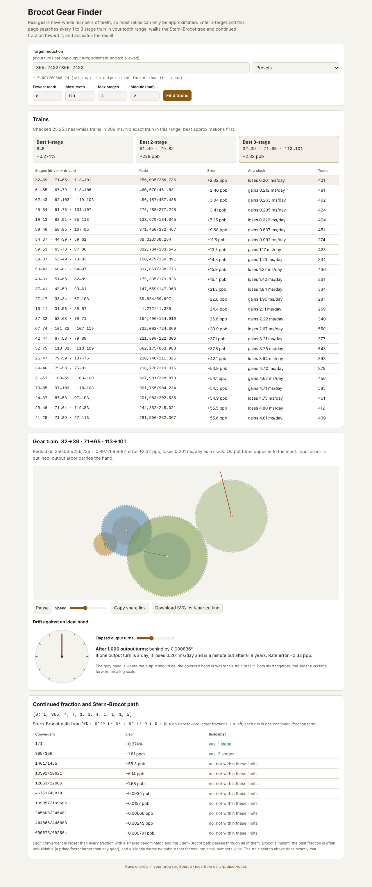

# Brocot Gear Finder

Real gears have whole numbers of teeth, so most ratios can only be
approximated. Type a target reduction (input turns per one output turn: 12 for
an hour hand, `24*60` for a daily dial on a 1 rpm motor, `365.2422/366.2422`
for sidereal time) and the page lists the most accurate 1 to 3 stage gear
trains inside your tooth range, shows the continued fraction and Stern-Brocot
path toward the target, and animates the chosen train in SVG next to a dial
that shows how far it drifts from an ideal hand.

Live: [brocot-gear-finder.netlify.app](https://brocot-gear-finder.netlify.app)

Built from idea 2026-10-05 n1 in
[`pisanuw/daily-project-ideas`](https://github.com/pisanuw/daily-project-ideas).



## What it does

1. **Target.** Any arithmetic expression (`+ - * / ^`, parentheses) or `a:b`.
   No `eval`: a small recursive-descent parser. Targets below 1 are step-up
   trains (the output turns faster).
2. **Search.** A compound train with k stages has k driving and k driven
   gears, and its reduction is prod(driven) / prod(driver). So N/D is buildable
   in k stages exactly when N and D are both products of k tooth counts in
   range. The search marks every such product once in a byte table (bit k-1 =
   "product of k teeth"), then for every possible driver product D tests the
   numerators nearest to target × D. One train is kept per reduced ratio (the
   fewest stages, then the fewest teeth), and the most even factorisation is
   chosen so you get 8→24 · 8→32 for 12, not 8→8 · 8→96. Sidereal time with
   8 to 120 teeth and 3 stages checks about 25,000 candidate trains in
   roughly 0.25 s.
3. **Results.** The best train for each stage count, then the 25 best overall
   with the ratio as a fraction, signed error (%, ppm or ppb), what that means
   as a clock (gains or loses s/day), and total teeth.
4. **Continued fraction and Stern-Brocot path.** The terms, the path from 1/1
   as run-length moves (R¹⁴³⁹ for 1440: each run is one term), and every
   convergent with whether it can be built within your limits. This is
   Brocot's point: the best fraction usually has a prime factor bigger than any
   gear, and a slightly worse neighbour that factors into small numbers wins.
5. **Animation.** Involute teeth (20° pressure angle, ISO addendum and
   dedendum) at the module you choose, correct centre distances, compound gears
   sharing arbors, and each arbor phased so the teeth actually interleave. The
   output arbor carries a hand.
6. **Drift.** A dial with the ideal hand and the train's hand after 1 to 10⁸
   output turns (log slider), with the time until it is a minute out if one
   output turn is a day.
7. **Share and cut.** The target, limits, module and selected train live in
   the URL fragment. "Download SVG for laser cutting" lays every gear out in
   millimetres with a bore, red cut lines and blue engraved labels.

Presets: hour hand, 24-hour dial, minute hand from a seconds escape wheel,
sidereal from solar time, moon phase, tropical year, Venus from Earth for an
orrery, π, and bicycle gearing.

## Design decisions

- **Exhaustive search, not only the tree.** The idea suggested walking the
  Stern-Brocot tree to list candidates. Walking it gives the best fractions
  but not the buildable ones, so the tree is shown for understanding and the
  trains come from the product-table search, which is exhaustive for N within
  ±1 of target × D.
- **At most 3 stages and 200 teeth.** The product table has max^stages bytes
  (8 MB at 200 teeth, 3 stages), which is fine in a browser; a 4th stage would
  need a different algorithm (meet in the middle).
- **No React or Tailwind.** Plain TypeScript and DOM like the other packages
  here; the bundle is about 23 kB.

## Limitations

- The layout is a schematic: it zig-zags arbors and does not check that a
  wheel on arbor i+2 clears the axle on arbor i, or that a 3-stage train fits
  a real clock plate. Small pinions (under about 17 teeth at 20°) would be
  undercut when cut; the outline does not model undercut.
- Only N within ±1 of target × D is tried for each D. That is all that can
  matter for the best trains, but the list below the top few is not every
  possible train.
- Error is relative to the number you type, so 365.2422 is only as good as
  that constant.

## Development

```bash
npm install
npm run dev        # http://localhost:5173
npm run lint
npm run typecheck
npm run coverage   # 44 vitest tests, 100% statements on src/core
npm run build
```

`src/core/` is pure and unit tested (expression parser, continued fractions,
search, gear geometry, drift, share links, cut sheet). `src/ui/` is the DOM
layer, checked by hand and with a Playwright smoke run.
