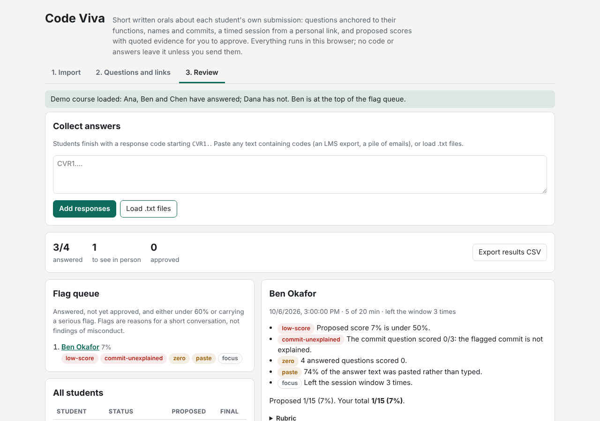
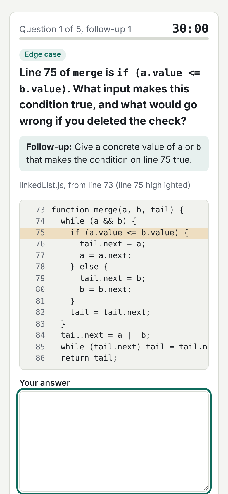

# Code Viva

Short written orals about each student's own submission. Import a Gradescope or
Canvas export or a GitHub Classroom assignment; Code Viva reads every student's
code and commit history and writes 4 to 6 questions anchored to *their*
functions, guards, data structures, unclear names and unusual commits. Each
student answers in a timed text session from a personal link, with up to two
follow-ups when an answer is vague. You review transcripts with proposed rubric
scores, quoted evidence and a flag queue, so TA time goes to the few students
who need a short conversation.

Live: [code-viva.netlify.app](https://code-viva.netlify.app)

Built from idea 2026-10-21 n1 in
[`pisanuw/daily-project-ideas`](https://github.com/pisanuw/daily-project-ideas),
prompted by the SIGCSE TS 2026 lightning talk on AI-driven oral examinations
for code.



## Workflow

1. **Import.** Upload a zip (Gradescope export with `submission_metadata.yml`,
   Canvas "Download submissions" with nested zips unpacked, or one folder per
   student), or import a GitHub Classroom assignment by organization and repo
   prefix. Add the assignment spec: functions it names are asked about first,
   and its must/should sentences become questions. Set per-student extended
   time (1.25x to 3x) for accommodations.
2. **Questions and links.** Review each student's questions next to the code
   excerpt they will see, replace or reword any of them, then copy each link or
   download a links CSV for a mail merge.
3. **Session.** The student opens the link, reads the rules, presses Start and
   answers one question at a time against the clock. Pastes, time per answer,
   leaving the window and restarts are recorded. At the end they get a
   response code (`CVR1.…`) to paste into the LMS or an email.
4. **Review.** Paste any text containing response codes. The flag queue lists
   students to see in person; each transcript shows proposed scores with the
   sentences they rest on. Override any score, add a note, approve, and export
   a results CSV.

Try **Load the demo course** on the Import tab: four invented submissions to a
linked-list assignment (Python, Java, JavaScript), three already answered by
scripted sessions played through the real session engine.



## How questions are built

The analyser blanks comments and string contents, then finds functions by
indentation (Python) or brace matching (JavaScript/TypeScript, Java, C, C++,
C#, Go, Rust, Swift). For each function it records loops, guards, recursion,
data structures (map, set, list, stack/queue, heap, sort), locals, vague names
(`tmp1`, `t2`, opaque two-letter names) and magic constants. Candidate
questions:

| Kind | Example |
|---|---|
| recursion | "`_sort` calls itself on line 56. What is the base case, and why does every call get closer to it?" |
| edge | "Line 27 of `remove` is `if cur is None`. What input makes this condition true, and what would go wrong if you deleted the check?" |
| design | "In `dedupe` you keep `seen` in a set (line 36). Why that choice rather than a list, and what does it cost?" |
| naming | "In `ms`, what does `pv` hold (first used on line 52)? What would be a clearer name for it?" |
| scale | "If the input to `sort` were 1,000 times larger, which part would dominate the running time?" |
| trace | "Walk through `remove(value)` on a small input you choose." |
| spec | "The assignment says: '…' Show where your code does this." |
| commit | "99% of the code arrived in commit 9f8e7d6. Walk me through how you developed `remove`…" |

Selection prefers the most complex functions, uses every available kind before
repeating one, allows at most two questions per function, always includes a
severe commit question (asked last), and is seeded by the student id so two
copies of the same starter code still get different questions.

**Commit statistics** (the MVP's "simple stats", not anomaly detection): a
commit that adds 120+ code lines and 40%+ of all code; a commit between 00:00
and 04:59 in the committer's own timezone with 40+ lines; one commit carrying
80%+ of the code; 50%+ of the code in the hour before the deadline. Commits by
`github-classroom[bot]` and other bots are ignored. A flagged commit is a
question for the student, never a verdict.

## Follow-ups and scoring

The same reading of an answer drives the session and the score. An answer is
*specific* if it names the question's identifiers, a line number or quoted
code; it *covers* the question's concept groups (for recursion: a base case,
and something getting smaller); it *explains* if it has 30+ words with a causal
link. A vague answer gets a follow-up aimed at what it is missing, never the
same follow-up twice.

Rubric per question (0 to 3): +1 specific, +1 covers at least half the concept
groups, +1 explains. "I don't know" scores 0. Replies that are mostly pasted
are shown but earn no credit. Every proposed score quotes the transcript
sentences it rests on, and nothing is final until you approve it.

Flags: proposed score under 50%, an answered question at 0, half or more of the
text pasted, the commit question at 1 or less, timing out with questions left,
leaving the window 3+ times, typing faster than 120 words per minute, restarts,
and a transcript that answers a different version of the questions than the one
issued. Flags rank who to talk to; they are not findings of misconduct.

## Privacy

Everything runs in the browser. Submissions and decisions live in this
browser's localStorage (export the course JSON to back it up). A viva travels
to the student inside the link's `#fragment`, which browsers do not send to
servers, and answers come back only as the response code the student chooses
to send. The GitHub import talks straight from your browser to
`api.github.com`; the token is held in memory for that import only.

## Departures from the idea

- **No LLM.** The idea's Claude API question generation and scoring are
  replaced by deterministic templates over a source analyser and a keyword
  rubric. Questions are less fluent than an LLM's, but they cannot hallucinate
  code that is not there, cost nothing, and give the same result every time.
- **No Supabase or Flask.** No accounts, database or worker: links carry the
  questions, response codes carry the answers, and the course is a JSON file.
- **Text only.** Voice mode, LTI and proctoring are out of scope, as in the
  idea's MVP.

## Limitations

- Response codes are not signed. A student could, with effort, edit their own
  transcript (for example the paste counts) before sending it. The viva id
  catches answers to edited or someone else's questions, not tampering with
  the answers themselves.
- The function finder is heuristic: macros, nested lambdas and unusual
  formatting can hide a function from the generator.
- The keyword rubric rewards naming the right things, so a student who knows
  the vocabulary but not the code can score a 1 or 2 on some questions. That is
  why scores are proposals and the transcript is always shown in full.
- Links for large question sets are a few kilobytes long; some LMS message
  boxes may wrap them, so the links CSV is the safer channel.

## Development

```bash
npm install
npm run dev        # http://localhost:5173
npm run lint
npm run typecheck
npm run coverage   # vitest with 85% thresholds
npm run build
```

`src/core/` is the tested, DOM-free logic (analyser, commit stats, question
generator, session state machine, scoring, links, zip and GitHub import, course
state, demo data); `src/ui/` is the hand-tested DOM layer.
