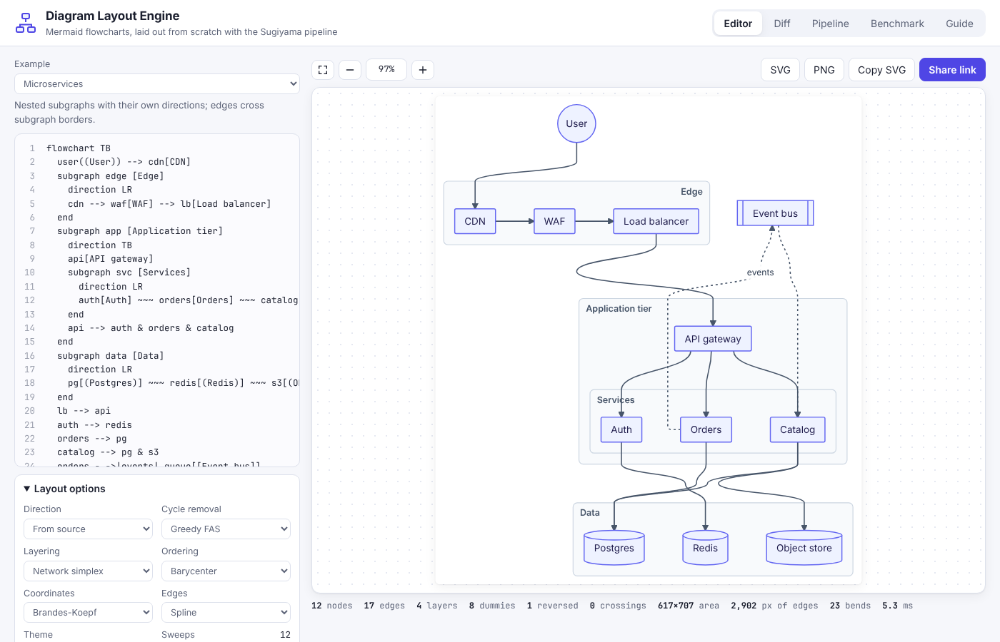
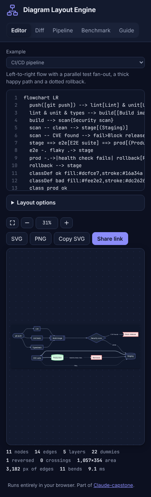

# Diagram Layout Engine

A layout engine for a subset of Mermaid flowchart syntax, written from scratch:
a recursive-descent parser, the five-step Sugiyama pipeline, an edge router and
a themeable SVG writer, plus a visual diff, a stage-by-stage inspector and a
benchmark. No Mermaid, dagre or ELK; no dependencies at runtime. Everything
runs in the browser.

Live: [diagram-layout-engine.netlify.app](https://diagram-layout-engine.netlify.app)

Built from the 2026-10-18 idea "Build Your Own Diagram Layout Engine", a
five-week classroom assignment prompted by the HN thread on Pele (Obsidian's
themeable Mermaid renderer), where people mostly asked for readable large
diagrams and for visual diffs. This is a reference solution and a test harness
for that assignment.



## What you can do

- **Editor.** Type Mermaid and the diagram re-lays out as you type. Ten bundled
  examples cover a CI/CD pipeline, a login flow with retry loops, nested
  microservice subgraphs, a compiler pipeline whose middle end runs in another
  direction, the TCP state machine, a CS prerequisite DAG, release branching
  drawn right to left, a shape gallery, a styled order flow and the engine's
  own pipeline. Every step of the pipeline has a switch (cycle removal,
  layering, ordering, transposition, sweeps, coordinates, edge style, gaps), and
  the metrics strip shows crossings, layers, dummy nodes, reversed edges, area,
  edge length, bends and time. Hover a node to highlight its edges; click it
  for its layer, order and size and a jump to its line in the source. Pan by
  dragging or scrolling, zoom with ctrl/cmd + wheel, pinch or the buttons,
  double-click to fit.
- **Errors.** The first parse error shows its line, column, a caret under the
  offending text and a "Go to error" button that selects it in the editor.
  Ignorable constructs (`click`, unsupported style properties, a `linkStyle`
  index with no edge) become warnings instead.
- **Themes.** Light, dark, forest, blueprint, sepia, high contrast, or auto
  (light with a dark override under `prefers-color-scheme`). Every colour in
  the SVG is a CSS custom property, so a theme change restyles without a new
  layout. A custom `fill` without a `color` gets dark or light text by
  luminance, so classDef colours stay readable in dark themes.
- **Export.** SVG (standalone, with the theme inlined), PNG at 2x, copy SVG,
  and share links that carry the source in the URL fragment, deflated.
- **Diff.** Paste two versions (or load one of two bundled pairs, or take the
  editor's diagram as "before"). Both are merged into one union graph and laid
  out once, so every node keeps its place; the before view shows removals in
  red with additions as faint ghosts, the after view the reverse, overlay shows
  both. Changed labels, shapes, subgraph moves and edge styles are amber. The
  change list highlights an element when clicked.
- **Pipeline.** The current diagram, stage by stage: the parsed node and edge
  tables, which edges cycle removal flipped, longest-path against network
  simplex layering with their total edge span, the dummy nodes, every
  crossing-minimisation sweep with its crossing count (a bar per step, the kept
  order in green), the assigned coordinates, and the routed result.
- **Benchmark.** Fifty seeded graphs (sparse and dense DAGs, trees, layered,
  cyclic, clustered with mixed directions) laid out with five configurations,
  ranked per graph on crossings, area, edge length and bends, with a
  per-graph crossing table whose rows open in the editor and a CSV download.

## Supported syntax

```
flowchart TD                 %% or graph; TB, TD, BT, LR, RL
A[Rect] --> B(Round) --> C([Stadium])
D[[Subroutine]] --- E[(Database)] -.-> F((Circle))
G(((Double))) ==> H>Flag] --o I{Diamond} --x J{{Hexagon}}
K[/Lean right/] <--> L[\Lean left\] ~~~ M[/Trapezoid\] --- N[\Inverted/]
O["Quoted (any) text"] -->|label| P[Two<br>lines]
Q -- text label --> R
S & T --> U ---> V          %% groups, chains, one extra layer
subgraph api [API tier]
  direction LR
  a --> b
end
client --> api              %% an edge to the subgraph box
classDef hot fill:#fee,stroke:#c00
class A,B hot
C:::hot
style D fill:#eef,stroke-width:2px
linkStyle 0,2 stroke:#c00
```

Nodes take the first subgraph that mentions them. Ids are letters, digits and
underscores (`end` is reserved, as in Mermaid).

## How the layout works

1. **Parse** (`src/core/parser.ts`). One statement at a time, longest shape
   opener first; the first error throws a `ParseError` with line, column and
   length.
2. **Subgraphs bottom-up** (`layout.ts`). Each subgraph runs the pipeline on
   its own children in its own direction and becomes a fixed box in its
   parent. An edge is laid out in the lowest subgraph containing both ends,
   between the boxes that contain them.
3. **Cycle removal** (`acyclic.ts`). Greedy feedback arc set (Eades, Lin and
   Smyth 1993) or DFS back edges. Reversed edges are drawn the right way round.
4. **Layering** (`rank.ts`). Longest path, or network simplex (Gansner et al.
   1993) with a tight feasible tree, cut values and leave/enter exchanges, run
   per connected component. Labelled edges double every edge length so the
   label gets its own layer.
5. **Normalization** (`layered.ts`). Dummy nodes split long edges; the label
   rides on the middle dummy.
6. **Crossing minimisation** (`order.ts`). DFS initial order, then down/up
   sweeps sorting by barycenter or weighted median, optional adjacent
   transposition, crossings counted with the Barth-Juenger-Mutzel accumulator
   tree, best order kept, early stop after four stale sweeps.
7. **Coordinates** (`position.ts`). Brandes-Koepf (type 1 conflicts, four
   vertical alignments, block-graph compaction, alignment to the narrowest,
   average median) or the priority method. Dummies use a smaller gap than real
   nodes; self-loops reserve room beside their node.
8. **Routing** (`route.ts`). Splines are cubic segments with tangents along
   the flow; orthogonal routes bend in tracks spread across the gap between
   layers; ports clip to each shape's outline polygon. Legs from a subgraph
   border to an inner node go straight when clear, otherwise through the
   nearest free lane between the other nodes in the box. Subgraph titles move
   left, right or centre to avoid edges.
9. **SVG** (`svg.ts`, `themes.ts`). Markers per head kind and colour, classDef
   and style inline, diff classes, all colours as `var(--dle-*)`.

## Benchmark result

With the seed in `bench.ts`, network simplex + barycenter + transpose +
Brandes-Koepf has the fewest total crossings (192), the smallest total area and
the fewest bends of the five configurations, which is why barycenter is the
default ordering. It does not top the mean rank, though: network simplex +
median + priority coordinates ranks best (1.84 against 2.00) because the
priority method gives shorter total edges, and the plain longest-path +
barycenter baseline still wins outright on some dense graphs. The five mean
ranks sit between 1.84 and 2.12, so no configuration dominates. Run it
yourself on the Benchmark tab; the CSV has every metric for every graph.

## Limitations

- Only flowcharts and the syntax above: no Markdown strings, icons,
  `@{ shape: ... }` metadata or click handlers.
- Subgraphs are fixed boxes in their parent, so the parent cannot interleave a
  subgraph's nodes with outside ones; a densely connected subgraph can come out
  wider than dagre or ELK would draw it, and a leg into a subgraph can still
  cross an edge inside it.
- Crossings are counted per scope on the layer graph; legs into subgraphs and
  self-loops are not part of that count.
- Text is measured with the browser canvas in the theme's font; an exported
  SVG opened where that font is missing can look a little tight or loose.
- Network simplex computes cut values naively (O(V·E) per exchange). That is
  instant for diagrams people write by hand, but would need the incremental
  postorder version for graphs with thousands of nodes.

## Layout

```
src/core/   parser, layered pipeline, routing, SVG, themes, diff, benchmark, examples
src/ui/     tabs, editor, pan/zoom viewport, diff view, pipeline inspector, benchmark view
test/       vitest: parser, algorithms (with brute-force checks), layout, output
```



## Develop

```bash
npm ci
npm run dev        # Vite dev server
npm run lint
npm run typecheck
npm run coverage   # 88 tests; core coverage 98.9% statements
npm run build      # static site in dist/
```

The tests include brute-force checks: network simplex matches an exhaustive
search for the optimal layering on small random DAGs, the accumulator-tree
crossing count matches pairwise counting, and greedy cycle removal stays within
the Eades-Lin-Smyth bound. One golden SVG snapshot guards the renderer, and
every bundled example is laid out with four option sets and checked for
overlapping nodes.

No environment variables. Deployed to Netlify by the repo's deploy workflow
from `deploy/target.yml`.
