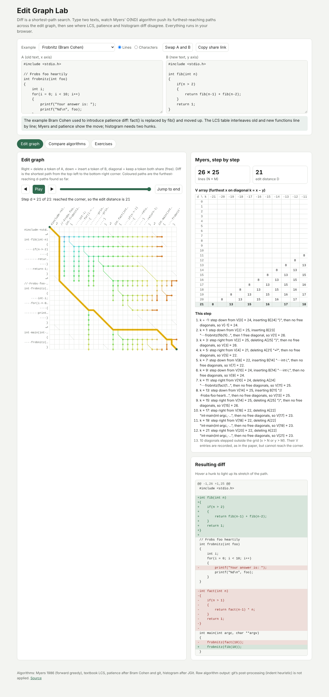

# Edit Graph Lab

Students run diff every day but rarely see that it is a shortest-path search.
Edit Graph Lab takes two short texts (lines or characters), draws the edit
graph as a grid with a diagonal wherever the two texts share a token, and
animates Myers' O(ND) algorithm as its furthest-reaching d-paths spread across
it, with the V array filling in beside the grid. The final path is turned into
a unified diff, and hovering a hunk lights up its stretch of the path. A
comparison view runs the LCS dynamic program, Myers, patience and histogram
diff on the same input and outlines where they choose different (equally short
or longer but more readable) hunks. An exercise generator writes questions
whose answers come from the reference implementations and exports them as
Markdown or QTI 1.2.

Live: [edit-graph-lab.netlify.app](https://edit-graph-lab.netlify.app)

Built from idea 2026-10-11 n2 in
[`pisanuw/daily-project-ideas`](https://github.com/pisanuw/daily-project-ideas).



## What it does

1. **Edit graph.** Columns are the tokens of A (x axis), rows the tokens of B
   (y axis). A step right deletes, a step down inserts, a diagonal keeps a
   shared token for free. Labels show blank lines as `⏎` and spaces as `·`.
   The graph is drawn for up to 160 tokens per side.
2. **Myers, step by step.** Forward greedy Myers (1986) in the
   quadratic-space form, so every step can be replayed. Step, play, or drag
   the slider through d = 0 … D. Paths found at step d are coloured by d, the
   current step is drawn thicker, and the solution path appears when the
   search reaches the corner. The V array is shown as the paper's triangle
   (rows d, columns k = x − y), and each step is explained in words ("k = 1:
   step down from V[2] = 7, inserting B[5] "C", then no free diagonals, so
   V[1] = 7"). Diagonals whose move leaves the grid are recorded, as in the
   paper, and summarised in one line.
3. **Unified diff.** GNU-style hunks: 3 lines of context, `@@ -s,l +s,l @@`
   with `,1` omitted and a zero-length side reported as the line before the
   change. Character mode renders an inline diff instead.
4. **Compare algorithms.** LCS (suffix-table DP, ties prefer deletion), Myers,
   patience (unique-line anchors via patience sorting, after Bram Cohen and
   git) and histogram (rarest common run, after JGit) on the same input. Each
   card shows D, extra edits over the minimum, hunk count, whether the kept
   token pairs match Myers, and outlines hunks that Myers does not produce.
   For inputs up to 24 × 24 the LCS table is drawn with its traceback.
5. **Readability traps.** Seven curated examples: Myers' ABCABBA/CBABAC,
   kitten/sitting (no substitutions in diff), an inserted function whose
   braces can slide, two swapped functions (after James Coglan), Bram Cohen's
   frobnitz, a reordered list (no "move" in diff), and blank-line-heavy prose.
   Each note describes what the algorithms in this lab actually do on it; a
   test checks the claims that matter.
6. **Exercises.** Four templates: predict D for a character diff, fill in
   V[k] after step d, pick which of two unified diffs patience produced, and
   count the hunks `diff -U1`/`-U2` prints. Seeded, so the same seed gives the
   same set. Each question has an answer and explanation, an "open in the edit
   graph" button, and Markdown or QTI 1.2 export (Canvas's import format).
7. **Share links.** Both texts and the mode are encoded in the URL fragment,
   so nothing is sent to a server.

## Design decisions

- **No backend, no LLM, no framework.** Plain TypeScript, DOM and SVG, like
  the other capstone tools; the bundle is about 34 kB.
- **Quadratic-space Myers.** The linear-space middle-snake version is what
  production diff uses, but it cannot show the V array step by step. Inputs
  are capped at 600 tokens per side, where the quadratic version is instant.
- **Cross-checked against the `diff` npm package.** On 400 random pairs the
  LCS and Myers edit distances equal the package's, every script from every
  algorithm replays A into B, and every unified diff the lab writes is
  accepted by the package's `applyPatch` for context 0, 1 and 3.
- **Histogram is simplified.** It picks the run whose rarest token is rarest,
  then the longest, which is order-independent but not exactly JGit's
  scanning rule, so on some inputs the two choose different, equally valid
  anchors.

## Limitations

- Output is raw algorithm output. Real git post-processes hunks (the
  "indent heuristic" slides change groups to blank-line boundaries), so git's
  diff can read better than what the lab shows for the same algorithm. The
  sliding-brace example is exactly such a case.
- Myers here is the forward greedy variant; git's Myers uses the
  bidirectional middle-snake search and can pick a different minimal path, so
  the lab's Myers is not guaranteed to match `git diff` line for line.
- Character mode works on Unicode code points, not grapheme clusters, and
  there is no whitespace-ignoring option.
- The QTI export has not yet been imported into Canvas; it follows the same
  template as the other capstone tools.

## Development

```bash
npm install
npm run dev        # http://localhost:5173
npm run lint
npm run typecheck
npm run coverage   # 36 vitest tests, coverage thresholds 85%
npm run build      # static site in dist/
```

The core (`src/core/`) is pure TypeScript and fully unit tested; the DOM layer
(`src/ui/`) is checked by hand in the browser.

## License

MIT
