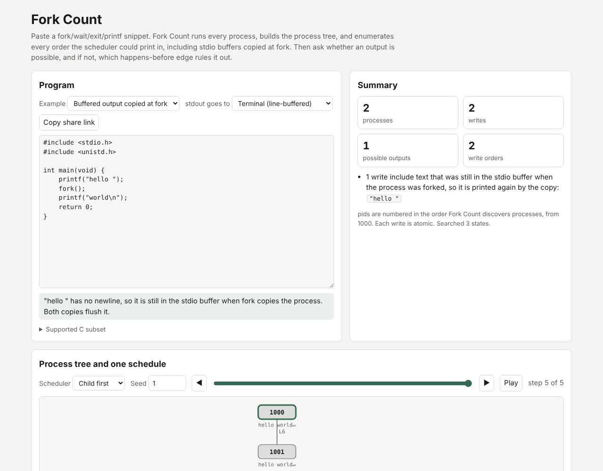

# Fork Count

"How many times is hello printed?" is on nearly every operating systems exam,
and most students guess. Paste a short fork/wait/exit/printf/pipe snippet and
Fork Count runs every process it creates, draws the process tree (with an
arrow for each pipe), and enumerates every output the scheduler could
produce, stdio buffers copied at fork included. Data sent through pipes,
`dup2` redirection, shell-style pipelines and the deadlocks you get from a
forgotten `close` are modelled too. Type an output and it says whether some
schedule prints it; if none does, it names the happens-before edge that rules
it out. A generator turns templates into new exam questions whose answers are
checked against every schedule.

Live: [fork-count.netlify.app](https://fork-count.netlify.app)

Built from idea 2026-10-09 n2 in
[`pisanuw/daily-project-ideas`](https://github.com/pisanuw/daily-project-ideas).



## What it does

1. **Interpreter.** A hand-written lexer and recursive-descent parser for a C
   subset: one `main()`, `int`/`pid_t`/`char` variables, one-dimensional
   `int` and `char` arrays (`int fd[2]`, `char buf[64]`, `char msg[] = "hi"`,
   `int a[] = {1, 2}`), `char *` strings and string arrays (an `argv` for
   `execvp`), `sizeof`, `if`/`else`, `for`, `while`, `do`, `break`,
   `continue`, `return`, and C's operators other than pointer arithmetic.
   Calls: `fork`, `wait`, `waitpid`, `exit`, `_exit`, `printf`,
   `fprintf(stdout|stderr)`, `sprintf`/`snprintf`, `puts`, `putchar`,
   `perror`, `fflush`, `setbuf`/`setvbuf`, `getpid`, `getppid`, `sleep`
   (ignored), `WEXITSTATUS`, `strlen`, `strcpy`, `strcat`, `strcmp`, `atoi`,
   the file-descriptor calls `pipe`, `read`, `write`, `close`, `dup`, `dup2`,
   and `execlp`/`execl`/`execvp`. `#include` lines are skipped, so textbook
   snippets paste in unchanged.
2. **Processes by re-execution.** A process is named by its fork decisions
   (the root is `[]`, its first child `[true]`, its second `[false, true]`).
   Running a process re-executes `main()` from the top, following those
   decisions until the process starts, then records its events. That
   reproduces the child's variables and stdio buffer exactly, so `fork()` can
   sit anywhere, including `fork() && fork() || fork()`.
3. **stdio buffering.** Line-buffered (terminal), fully buffered (file or
   pipe, 4096 bytes) or unbuffered, switchable in the UI or by
   `setbuf`/`setvbuf` in the code. Text still buffered at fork is printed by
   both copies, `_exit` and `exec` throw it away, `write` and `stderr` skip
   it. The summary points out every write that contains inherited text.
4. **Every schedule.** Happens-before is program order, parent fork before
   child, and child exit before the `wait` that reaps it. The search branches
   only on which ready process writes next. Forks, exits and satisfiable waits
   run eagerly (they are invisible and only enable more steps), and states are
   memoised on a canonical form where processes with identical futures are
   interchangeable, so `for (i = 0; i < 4; i++) { fork(); printf("hi\n"); }`
   (16 processes, 30 writes) needs about 200 states instead of millions.
5. **Pipes.** `pipe(fd)` hands out the lowest free descriptors, and each
   process has its own descriptor table, copied at fork. A read happens after
   the write whose bytes it returns; a read that returns 0 (end of file)
   happens after every process holding a write end has closed it or exited,
   which is why a forgotten `close(fd[1])` hangs the reader. Each pipe needs
   one writing and one reading process, and a `write` reaches the reader as
   one unit (a read returns the unread part of the oldest write, up to the
   size asked for), so the bytes a process reads are the same in every
   schedule; only *when* it reads them varies. A reader can depend on a
   process that has not run yet, so the runner suspends it and re-runs it as
   data appears; when nothing can progress, pipes no live process can write
   to reach end of file, and whatever is still waiting is blocked for good.
   `dup2(fd[1], 1)` sends `printf` into the pipe, and stdio picks full
   buffering if stdout is already a pipe when it is first used. `exec` runs
   small built-in filters that read their stdin: `echo`, `cat`, `wc`,
   `sort`, `uniq`, `grep`, `head`, `tr`, `rev`, `true`, `false`; anything
   else prints a `<program args>` placeholder line.
6. **Deadlocks.** A state where some process has not finished but nothing can
   run is a deadlock. Outputs that end in one are listed as such, the
   summary explains who is stuck where ("pid 1001 is blocked in read() at
   line 14 ... but pid 1001 itself still holds a write end"), and the
   checker accepts an output that stops at a hang and says so.
7. **Is this output possible?** Exact, whatever the number of outputs. A
   no comes with reasons: the character count that every run prints, the
   longest prefix some schedule can produce, and for each write that would fit
   next, the chain of edges blocking it ("pid 1000 is blocked in wait() at line
   12 until one of its children exits, and pid 1001 still has to print
   "child\n""). A yes comes with a schedule that prints it.
8. **Process tree and one schedule.** An SVG tree with fork lines on the
   edges and a dashed arrow from each pipe's writer to its reader, stepped
   through a parent-first, child-first or seeded random schedule, with
   each process shown as not yet forked, runnable, blocked in wait, zombie,
   orphan, or reaped; a schedule that ends in a deadlock says so.
9. **Exam questions.** Eight templates (fork loops, print before fork,
   short-circuit forks, wait/no wait, nested forks, loop counters, parent vs
   child, a pipe used as a barrier) mutated by a seeded RNG. A "how many times" question is kept only
   when the count is the same in every schedule; a "which outputs are
   possible" question gets two real outputs and wrong ones built by swapping,
   dropping or doubling lines, each checked exactly. Export as Markdown or QTI
   1.2 (numerical and multiple-answers items, the dialect Canvas imports).

Thirty-seven examples. Thirteen cover the fork classics: three forks in a
loop, the duplicated `hello world`, the same loop redirected to a file,
`wait`, short-circuit forks, the loop counter, separate memory, `exit` vs
`_exit`, `exec`, `waitpid` on one child, exit status, `write` vs `printf`,
and an orphan. Twenty-four cover pipes: a message to the child, a reply to
the parent, sending an int, reading until end of file, a reader and a parent
that forget to close the write end (both hang), a pipe as a barrier, what a
read does not order, ping-pong over two pipes, a two-way read-first
deadlock, `echo | wc -w`, a parent feeding `sort`, a three-stage
`echo | tr | rev`, a relay through a grandchild, reading in small pieces,
end of file waiting for every holder, one pipe per child, a buffered
`printf` that lands in the pipe after `dup2`, stdout becoming fully buffered
in a pipe, `cat` forwarding as it reads, pipe vs exit status (300 vs 44),
`grep` with its exit status, `close(1); dup()`, and a pipe inside one
process. The program and buffering mode live in the URL fragment for
sharing.

## Design decisions

- **No LLM and no D3.** The idea's stack listed D3 for the tree; a 25-line
  tidy layout and plain SVG do the job, and the bundle is about 87 kB
  (27 kB gzipped).
- **One writer and one reader per pipe, writes delivered whole.** With those
  two rules the data each process reads is fixed, so a process stays a
  deterministic function of its fork decisions and the schedule search only
  has to decide *when* things happen. Several writers into one pipe, or a
  slow reader that gets two writes in one `read`, would make a process's
  behaviour depend on the schedule; Fork Count reports the first as an error
  and does not model the second.
- **Pipe programs skip symmetry reduction.** A pipe ties two particular
  processes together, so states are memoised on plain event counters.
  Programs with pipes are small enough that this does not matter.
- **Re-execution instead of cloning interpreter state.** Copying a tree-walking
  interpreter mid-expression is fiddly; replaying the deterministic prefix is
  short and obviously correct, and programs this size run in microseconds.
- **Search budget.** Enumeration stops at 50,000 canonical states or 2 million
  set insertions (about a third of a second), and lists at most 2,000 outputs
  (the count is then shown as "at least"). Past the budget the tree and
  single schedules still work.
- **Soundness check.** The test suite compares the reduced search against a
  brute-force enumerator (every interleaving of every event, no memo) on all
  presets, generated questions and extra wait/waitpid programs.

## Limitations

- pids are numbered in the order Fork Count discovers processes, not the order
  a kernel would hand them out, and `getppid()` returns the original parent
  even after the parent exits (a real orphan sees init, or a subreaper). Output
  that prints pids is therefore one consistent labelling, not every possible
  one.
- `wait(NULL)` may reap any finished child in the schedule search, but the
  value it returns to the program is the oldest unreaped child. Programs that
  branch on which pid `wait` returned are explored for that one case only.
- Each `write` is atomic and there is no shared memory, signals, files,
  `vfork`, threads or helper functions. `exec` runs a handful of built-in
  filters (`echo`, `cat`, `wc`, `sort`, `uniq`, `grep`, `head`, `tr`, `rev`,
  `true`, `false`); other programs print a `<program args>` placeholder line.
- Pipes: one writing and one reading process each (two of either is an
  error), unlimited capacity (a writer never blocks), no `SIGPIPE` (writing
  with no reader left succeeds), and a `read` never merges two writes.
  Reading the terminal (fd 0 not redirected) returns end of file at once.
  `wait(&status)` on a child that never exits blocks; `wait(NULL)` before
  data the child needs shows up as a deadlock in the schedule search.
- The QTI export follows the Canvas QTI 1.2 dialect but has not been imported
  into a live Canvas course yet.

## Development

```bash
npm install
npm run dev        # Vite dev server
npm run lint
npm run typecheck
npm run coverage   # vitest, 165 tests, thresholds 85%
npm run build      # dist/
```

Core logic lives in `src/core` (parser, interpreter, schedule search, quiz,
tree layout, share links) and is unit tested; `src/ui` is the DOM layer.
