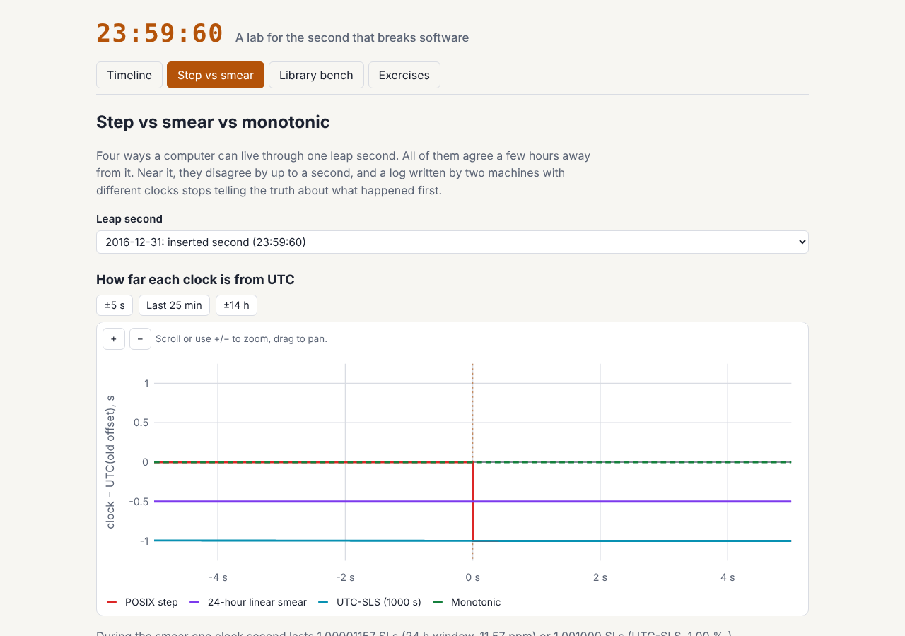

# 23:59:60

A timekeeping lab for systems and databases courses. It puts TAI, UTC, GPS,
Unix time and UT1 on one zoomable timeline, replays a leap second through
four kinds of clocks and a two-host event log, shows what JS `Date`,
Temporal, Python and Postgres actually do with leap-second inputs, and ends
with four fix-the-bug exercises with hidden tests.

Live: [leap-second-lab.netlify.app](https://leap-second-lab.netlify.app)

Built from idea 2026-10-17 n2 in
[`pisanuw/daily-project-ideas`](https://github.com/pisanuw/daily-project-ideas),
which was prompted by the decision to stop inserting leap seconds. The idea's
optional Claude API explainer is replaced by a hand-written note for each
recorded result. Everything runs in the browser; there is no backend.



## The four tabs

**Timeline.** TAI − UTC (27 steps, 10 s → 37 s), GPS − UTC (from 1980),
UT1 − UTC and Unix − UTC, as offsets from UTC in seconds, 1972 to the year
6000. Scroll or use +/− to zoom, drag to pan. Inputs set the cutover date
(when leap seconds stop), the excess length of day, how fast that excess
grows, and an optional hypothetical negative leap second. Readouts say when
|UT1 − UTC| would reach a minute and an hour, and how many leap seconds the
old rule would have needed by 2100. A converter turns any UTC label,
including `23:59:60.5`, into TAI, GPS week/time-of-week, the value a stepping
kernel reports, and UT1 − UTC. It rejects labels that never existed, such as
`2017-06-30T23:59:60`.

**Step vs smear.** Pick the 2016-12-31 inserted second or a hypothetical
removed second at the end of 2029-12-31. A chart shows how far each clock is
from UTC: POSIX step (repeats 23:59:59, or skips it), a 24-hour noon-to-noon
linear smear, UTC-SLS (smear only the last 1,000 s), and a monotonic clock. A
slider reads every clock at one instant. A two-host log simulator (seeded, so
results reproduce) has host A send requests to host B, merges both logs by
timestamp and counts out-of-order pairs, receives logged before sends,
clocks running backwards, mismeasured round trips and identical stamps for
different seconds. The merged log is listed around the leap with late rows
shaded.

**Library bench.** Ten edge cases (parse `:60`, parse `:60.5`, the Unix value
of `:60`, a `:60` that never happened, the length of the last second of 2016,
the length of 2016, adding 86,400 s across the leap, a removed `23:59:59`,
how long that removed second lasts, and sorting around the leap), each run
in JS `Date`, the Temporal polyfill, Python and Postgres. Every result is
badged *right*, *error* (it fails where you can see it) or *silently wrong*,
next to the answer this app's own leap-second-aware library computes.

**Exercises.** A request timeout, a token-bucket rate limiter, a
billing-duration function and a log merger, each with buggy starter code.
Hidden tests replay the leap second through a simulated clock:
`clock.wallMs()` behaves like `Date.now()` on a stepping kernel and
`clock.monotonicMs()` like `performance.now()`. Student code runs in a Web
Worker with a 3 s limit. Drafts are kept in `localStorage`, which can be
missing or blocked, and the page works without it.

## The recorded bench

`npm run bench` (`scripts/record-bench.mjs`) runs every snippet and rewrites
`src/data/bench.json`. Results in this commit were recorded on 2026-10-31
with Node.js v22.23.4, `@js-temporal/polyfill` 0.4.4, CPython 3.11.18 and
PostgreSQL 16.15. Set `PSQL` to reach Postgres (for example
`PSQL="psql -h localhost -U postgres" npm run bench`); if it cannot connect,
the previous Postgres results are kept. Some results worth knowing:

- Temporal accepts `23:59:60` and clamps it to `23:59:59`, so a reading taken
  during the leap second collides with the second before it.
- Postgres rolls `23:59:60` over to midnight, but rejects `23:59:60.5`, so a
  log line stamped inside the leap second cannot be loaded.
- `Date` rejects every `:60`, so `Date.parse` returns `NaN` and a sort that
  uses it comes back unsorted.
- Every runtime says the last second of 2016 lasted 1 s (it was 2) and none
  of them can tell a real leap second from one that never happened.

## The time model

An instant is a number on the TAI scale, defined so that
`tai = POSIX(UTC label) + (TAI − UTC)`. Differences are true SI seconds, and
`23:59:60.x` maps to the second between 23:59:59 and midnight. The leap table
is the 27 IERS leap seconds and can take extra entries of either sign. GPS is
TAI − 19 s. The model starts on 1972-01-01. Pre-1972 "rubber second" UTC is
out of scope.

## Limitations

- **UT1 before the cutover is a schematic.** It is drawn as a sawtooth from
  +0.5 s to −0.5 s between leap seconds, not IERS Bulletin data. After the
  cutover it is a two-parameter quadratic model (excess length of day plus its
  growth per century). Real Earth rotation is not predictable decades ahead.
- **Cutover date.** The default (2027-05-20) is the date given in the idea
  brief. I could not verify it from here. The 2022 CGPM Resolution 4 only says
  "by or before 2035". It is an input.
- **The bench is recorded, not live.** It shows one version of each runtime.
  The idea's Pyodide exercises are not included: the exercises are
  JavaScript only.
- The smear models are idealized linear ramps. They are not a trace of any
  provider's real NTP servers.

## Development

```bash
npm install
npm run dev        # Vite dev server
npm run lint
npm run typecheck
npm run coverage   # vitest, ≥85% thresholds on src/core
npm run build
npm run bench      # re-record src/data/bench.json
```

The core (`src/core/`: time scales, clocks, event log, UT1 model, exercises
and bench verdicts) has 47 vitest tests and 99.7% statement coverage. Every
exercise's starter code is tested to fail and its reference fix to pass. The
DOM glue (`src/ui/`) was checked in Chromium at 1280 px and 390 px widths.
