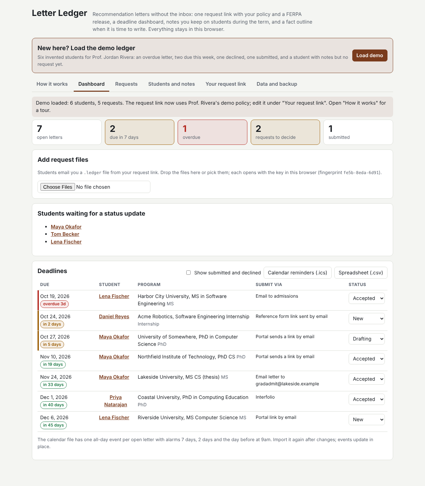
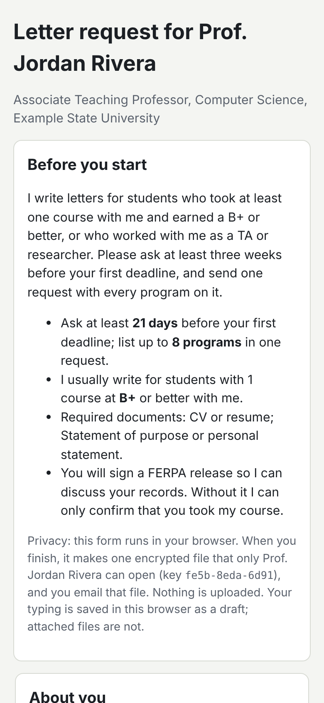

# Letter Ledger

Recommendation letters without the inbox. Each professor gets a personal
request link that carries their policy (notice period, grade rule, required
documents, questions). Students fill in one form, sign a FERPA release by
typing their name, and get one encrypted `.ledger` file to email. The
professor drops the files on a deadline dashboard, accepts or declines each
program, sends status updates from their own mail app, keeps a notes timeline
on students during the term, and exports a fact outline when it is time to
write.

Live: [letter-ledger.netlify.app](https://letter-ledger.netlify.app) (once the
deploy workflow has run on `main`)

Built from idea 2026-10-22 n3 in
[`pisanuw/daily-project-ideas`](https://github.com/pisanuw/daily-project-ideas).



## Workflow

1. **Your request link.** Set your name, institution, email, notice period
   (default 21 days), most programs per request, an optional minimum grade
   (letters or UW-style grade points) and how many courses must meet it,
   required documents, your conditions, and questions for the student (one per
   line; end a line with "(optional)" to make it optional). Copy the link.
2. **Student form.** Programs with letter deadlines, submission method, link
   and why that program; courses with the professor (term, grade, role);
   documents (CV, statement, transcript, photo, other; 8 MB each, 20 MB
   total); answers; and the FERPA release. Errors (missing pieces, a past
   deadline, an unsigned release) block the file; warnings (short notice, grade
   rule not met) are shown once and can be overridden. The form draft (not the
   files) is kept in the student's browser.
3. **Dashboard.** Drop `.ledger` files to file them under the student
   (matched by email, so notes taken earlier are waiting). Tiles count open,
   due-this-week, overdue and undecided letters; the table sorts every
   program by deadline with an inline status (new, accepted, drafting,
   submitted, declined). Download calendar reminders (.ics) or a CSV.
4. **Requests.** Policy check as of the request date, release check (consent,
   signature matches the name, every program named, text unchanged since
   signing), documents, answers, per-program notes, "Accept all", "Decline
   all", and "Email status update", which opens a ready email in your mail app
   and clears the student from the waiting list.
5. **Students and notes.** Quick capture (`Maya Okafor: great question on
   hashing #oh`), a dated notes timeline per student tagged class, office
   hours, project, research, TA or other, courses from your roster, and
   "Delete student and all their data" for a deletion request.
6. **Fact outline.** Markdown built only from the ledger: release terms,
   courses and how long you have known the student, your notes by tag, what
   the student asked you to highlight, each program's tailoring, a
   five-paragraph structure (paragraph 4 changes per program when one letter
   serves several), and a "before you write" checklist of gaps. Grades are
   left out when the release does not cover them.
7. **Data and backup.** One backup file with the ledger, policy, private key
   and documents, optionally encrypted with a passphrase; restore moves
   everything (including the key, so old links keep working) to another
   browser.

## Design decisions

- **No backend.** The idea suggested Supabase, Resend, Stripe and the Claude
  API. Here the request travels as a file the student emails, so no server ever
  holds a CV, grade or note. The policy rides in the link's URL fragment, which
  browsers do not send to servers.
- **Encrypted packets.** The professor's browser makes an ECDH P-256 key
  pair; the public key is in the link. The student's browser seals the packet
  with an ephemeral ECDH key, HKDF-SHA-256 and AES-256-GCM. The fingerprint is
  shown on both sides. Backups use PBKDF2-SHA-256 (600,000 rounds) and
  AES-256-GCM.
- **FERPA release.** The text is generated from the student's choices and
  names the records, the purpose and the programs (34 CFR 99.30), records the
  waiver choice, and is stored verbatim with a SHA-256 so edits after signing
  are caught on import.
- **Reminders and status emails without a mail service.** Reminders are an
  .ics with stable UIDs (re-import updates events) and alarms 7 days, 2 days
  and the day before at 9am. Status updates are `mailto:` drafts the professor
  sends.
- **No AI drafting.** The idea lists style-matched drafting as out of the MVP
  scope; the outline is deterministic and cites only recorded facts.

## Limitations

- A typed name is an electronic signature, not proof of identity. Confirm a
  request from the student's university email when it matters.
- Everything lives in one browser (localStorage for the ledger, IndexedDB for
  documents). Clearing site data erases it; download a backup.
- Losing the private key (no backup, cleared storage) makes request files sent
  to the old link unreadable. A fresh key gives a new link.
- Browsers cannot attach files to a `mailto:` draft, so the student attaches
  the `.ledger` file themselves.
- No shared department or TA notes, no portal upload, no billing.

## Development

```bash
npm ci
npm run dev        # http://localhost:5173
npm run lint
npm run typecheck
npm run coverage   # 85% thresholds on src/core
npm run build
```

`src/core` is pure TypeScript (policy, link codec, sealing, release, request
checks, ledger, calendar, status email, outline, backup, demo) and fully unit
tested; `src/ui` is the DOM layer and is exercised in the browser.


