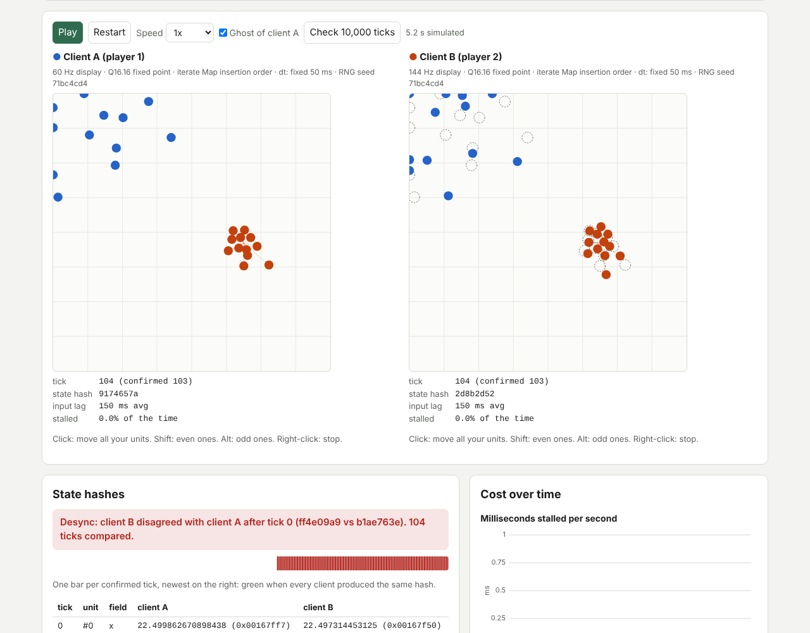

# Lockstep Lab

RTS games such as Total Annihilation kept thousands of units in sync by
sending only player inputs and running an identical simulation on every
machine. That works only if the simulation is perfectly deterministic.
Lockstep Lab runs a tiny unit simulation on two to four simulated clients
side by side, connected by a fake network with latency, jitter, loss and
reordering. Switch on a source of nondeterminism and watch the per-tick
state hashes split, with a diff that names the first unit and field that
differ. A second view compares input-delay lockstep with GGPO-style rollback
across input delays, and five autograded exercises ask students to fix a
nondeterministic step function until it survives 10,000 ticks on two
simulated machines.

Live: [lockstep-lab.netlify.app](https://lockstep-lab.netlify.app)

Built from idea 2026-10-12 n2 in
[`pisanuw/daily-project-ideas`](https://github.com/pisanuw/daily-project-ideas).



## What it does

1. **Side-by-side clients.** Each pane is a full copy of the game: idle
   units wander using the game RNG, commanded units walk to a target, and
   overlapping units push each other apart one pair at a time. Scripted
   players issue commands; click a pane to command that client's units
   yourself (shift: even units, alt: odd units, right-click: stop). A dashed
   ghost of client A's units shows the drift on the other panes.
2. **Fake network.** One-way latency, uniform jitter, packet loss and an
   optional in-order channel, all seeded. Every packet carries all inputs the
   peer has not acknowledged, so a lost packet is covered by the next one.
3. **Nondeterminism toggles.**
   - *Arithmetic:* Q16.16 fixed point (integer table sine), float32 on two
     identical platforms, or float32 where client B keeps intermediates in
     double precision (as x87 or FMA contraction does) and uses a different
     libm.
   - *Unseeded RNG:* each client seeds from its own "clock".
   - *Map iteration order:* each client created its own units first and the
     simulation iterates the `Map`, so RNG draws and separation pushes happen
     in a different order.
   - *Frame-rate timestep:* a 60 Hz and a 144 Hz machine advance by their
     measured frame time instead of the fixed tick.
4. **State hashes and first-divergence diff.** Each confirmed tick is hashed
   (FNV-1a over every unit field, the RNG state and the tick, in id order).
   A strip shows match or mismatch per tick and the diff table shows the
   first differing unit, field and both bit patterns. "Check 10,000 ticks"
   fast-forwards to verify a configuration.
5. **Lockstep vs rollback.** Lockstep runs tick t only when it holds every
   input for t; late input stalls the client and the game clock with it.
   Rollback predicts "no new command" for missing remote input, runs ahead up
   to a prediction limit, and on a misprediction restores the snapshot and
   re-simulates. Per-client stats show input lag, time stalled, rollbacks and
   re-simulated ticks, a per-second chart tracks cost, and a sweep over input
   delays 0 to 8 plots input lag and cost for both models on the current
   network.
6. **Exercises.** Five broken `step(world, api, Math)` bodies (wandering
   units, frame-rate physics, first-come pad claims, orbiting drones, and all
   of them combined). The grader runs your code in a Web Worker on two
   simulated machines that differ where real ones do: `Math.random` is seeded
   per machine, `Math.sin`/`Math.cos` come from different libms,
   `api.frameDt` is the machine's own frame time, and `world.units` was
   filled in a different order. It hashes the world after every tick, reports
   the first divergence, and also checks that the units still do something.

Eight scenario presets cover each lesson, including "floats on identical
machines", which stays in sync: floats are deterministic, platforms are not.

## Design decisions

- **No backend, no LLM, no framework.** Plain TypeScript, DOM and Canvas;
  about 48 kB of JavaScript plus a 15 kB worker.
- **One main-thread simulation instead of a worker per client.** All
  clients and the network advance together in 1 ms steps so a run is fully
  reproducible from its seed; workers would add real scheduling
  nondeterminism the lab cannot show or control. Only the exercise grader,
  which runs untrusted student code, uses a worker (with a 20 s timeout).
- **Simulated platforms.** JavaScript's `+ - * / sqrt` are IEEE 754 correctly
  rounded on every engine, so two tabs on one machine can never desync for
  floating-point reasons. The lab models the C/C++ situation instead:
  per-operation float32 rounding vs rounding only on store, and two libms.
- **Rollback checked against lockstep.** With scripted inputs and all
  nondeterminism off, the confirmed state at every tick must not depend on
  the netcode or the network; a test runs rollback over a 200 ms, 15%-loss
  network and compares its hashes with lockstep's.

## Limitations

- The "different platforms" float model is exaggerated: libm B differs from
  the engine's `Math.sin` by up to about 3e-7, far more than real libms, and
  the double-rounding in angle wrapping makes the float preset diverge within
  the first ticks rather than after minutes.
- The exercise grader shadows only `Math.random`, `sin`, `cos` and `tan`;
  other transcendental functions (`Math.exp`, `pow`, `hypot`) are not
  per-machine, so code using them is not flagged.
- Prediction is "no new command", which suits RTS-style discrete commands;
  there is no time-sync (frame advantage) negotiation as in GGPO, and
  lockstep simply slows down instead of adapting its input delay.
- Desync detection compares hashes directly instead of exchanging them over
  the fake network, and only the last 256 confirmed states per client are
  kept for the diff.

## Development

```bash
npm install
npm run dev        # http://localhost:5173
npm run lint
npm run typecheck
npm run coverage   # 46 vitest tests, coverage thresholds 85%
npm run build      # static site in dist/
```

The core (`src/core/`) is pure TypeScript and fully unit tested; the DOM layer
(`src/ui/`) is checked by hand in the browser.

## License

MIT
