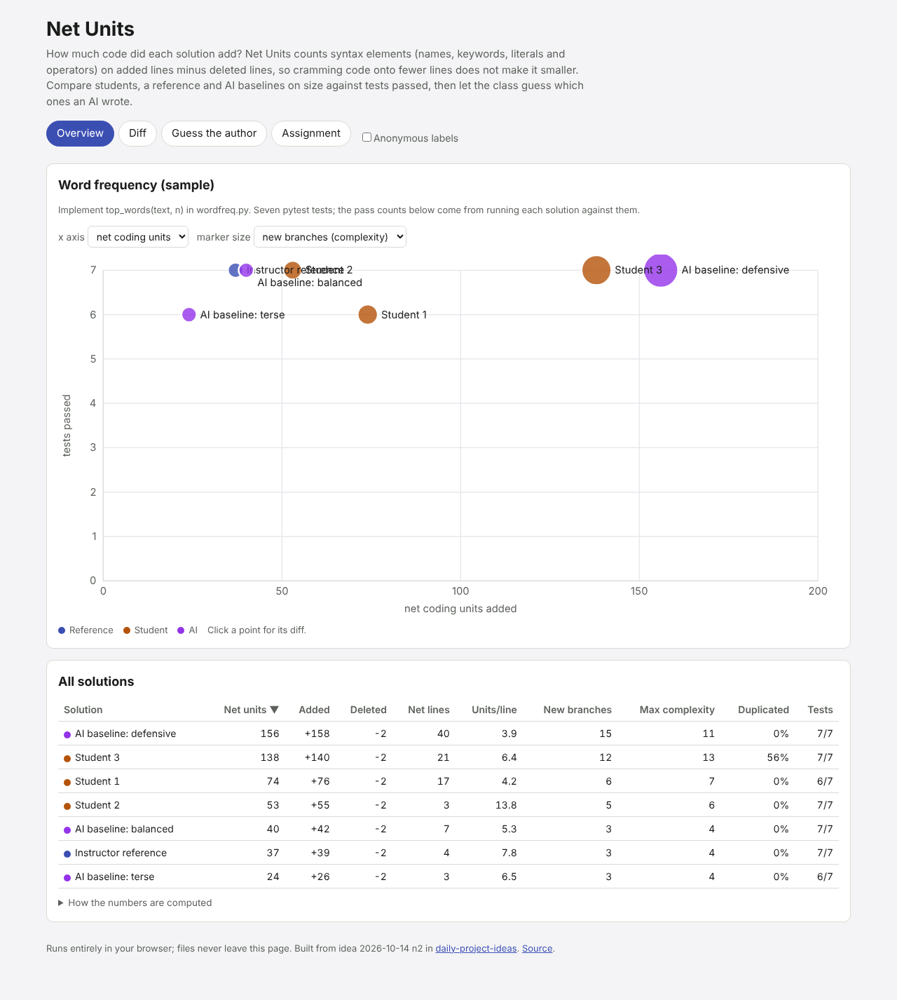

# Net Units

AI tools (and some students) ship code that works but is twice as long as it
needs to be. Net Units gives a class a number for "how much did you add?":
it counts **coding units** (names, keywords, literals and operators) on the
lines a solution added, minus those on the lines it deleted, measured
against the starter code. Because punctuation, comments and layout are not
counted, cramming code onto fewer lines does not make it look smaller. Each
solution is plotted on a size vs tests-passed scatter with complexity and
duplication overlays; click one to see its diff with every counted unit
highlighted, then run a "guess the author" round before revealing which
solutions an AI wrote.

Live: [net-units.netlify.app](https://net-units.netlify.app)

Built from idea 2026-10-14 n2 in
[`pisanuw/daily-project-ideas`](https://github.com/pisanuw/daily-project-ideas),
inspired by the Parsimony benchmark, which ranks models by the net code they
add to solve SWE-bench tasks.



## What it does

1. **Overview.** Scatter of net coding units (or net lines, to show the
   difference) against tests passed, with marker size showing new branches
   or the duplicated share. A sortable table adds units added and deleted,
   units per line, new branches, the maximum complexity of the touched
   functions and the duplicated share.
2. **Diff.** Side-by-side line diff against the starter for each file, with
   counted units highlighted on added and deleted lines, unchanged runs
   folded, and a per-function table (net units, and complexity before and
   after).
3. **Guess the author.** Solutions get shuffled codenames and each card shows
   only the added lines. Tally a show of hands per card, then reveal the
   authors and how often the class was right. Exports: an annotation sheet in
   Markdown (every hunk under its codename with a blank "earns its keep or
   not" line for discussion sections) and an anonymized assignment JSON.
4. **Assignment.** Upload the starter and each solution as a folder or a set
   of files, set each solution's author (student, reference, AI) and tests
   passed, edit code in place, and import or export the whole assignment as
   JSON. Everything stays in the browser (localStorage).

A sample assignment is bundled: `top_words(text, n)` in Python, with an
instructor reference, three student solutions (verbose, crammed onto four
lines, and a duplicated bubble sort) and three AI-style baselines (terse,
balanced, defensive). The tests-passed counts are real: each solution was run
against the sample's seven pytest tests. The terse baseline uses
`most_common()`, which breaks ties by first appearance, so it fails the
alphabetical tie test with the smallest code of all.

## How the measures work

- **Coding units.** A hand-written lexer for Python, JavaScript/TypeScript,
  Java and C/C++ splits code into tokens. Names, keywords, numbers, strings
  and operators count one unit each; brackets, commas, colons, semicolons,
  dots, comments and whitespace count zero.
- **Net units.** A longest-common-subsequence line diff against the starter
  file; units on added lines minus units on deleted lines. A changed line
  counts as one deletion plus one addition, so net is exact while the gross
  "added" figure is pessimistic. Files a solution leaves out count as
  unchanged; files not in the starter count as all-new.
- **New branches.** McCabe complexity (1 + `if`, `elif`, `for`, `while`,
  `case`, `catch`/`except`, `and`/`or`, `&&`, `||`, `?:`, `??`) per function,
  after minus before, summed over functions with added code. Functions are
  found by indentation in Python and by brace matching (`name(...) {`,
  `function`, `=> {`) elsewhere.
- **Duplication.** Unit tokens are normalized (every name becomes `I`,
  every number `N`, every string `S`) and any 12-unit window that appears at
  least twice in the solution marks its tokens as duplicated, so a copy with
  renamed variables still counts. The score is the duplicated share of the
  added units.

## Design decisions

- **No backend, no LLM.** The idea suggested a Flask service, tree-sitter,
  Supabase and Claude-generated baselines. All of it runs client-side
  instead: a ~250-line lexer replaces tree-sitter (counting needs tokens, not
  a full syntax tree), assignments live in the browser, and the AI baselines
  are bundled examples or files the instructor uploads. That keeps it free,
  offline, and safe to use with student code that must not leave the room.
- **Instructor-entered test counts.** Running arbitrary submissions in four
  languages in the browser is out of scope; the tool measures size, the
  instructor supplies correctness.
- **Plain TypeScript, DOM and SVG**, no framework: about 47 kB of JavaScript.

## Limitations

- The bundled AI baselines were written by hand to illustrate each style;
  they are not model output. Upload real model solutions for a genuine
  guessing round.
- The lexer is not a parser: JavaScript regex literals are split into
  operators and names, template-literal interpolations count as one string,
  and C macros are tokenized like code. Function attribution is heuristic, so
  C++ constructor initializer lists and macros can land on the wrong name.
- The diff is line-based, so moving a block shows as a deletion plus an
  addition (net zero, but large gross numbers), and there is no rename
  detection across files.
- Votes are tallied on one screen; there is no per-student voting from
  phones.

## Development

```bash
npm install
npm run dev        # http://localhost:5173
npm run lint
npm run typecheck
npm run coverage   # 39 vitest tests, coverage thresholds 85%
npm run build      # static site in dist/
```

The core (`src/core/`) is pure TypeScript and fully unit tested; the DOM layer
(`src/ui/`) is checked by hand in the browser.

## License

MIT
