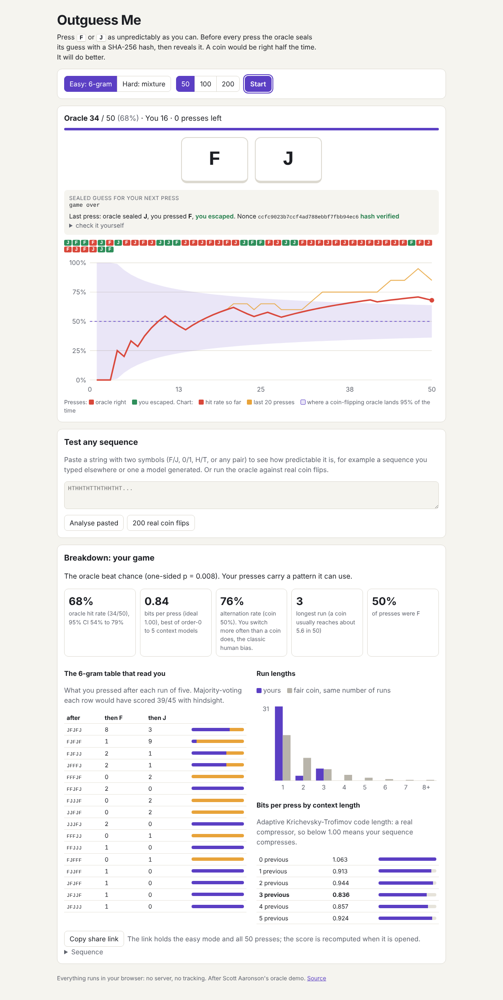

# Outguess Me

Press F or J as unpredictably as you can. Before every press an n-gram oracle
predicts your next key and seals the guess with a SHA-256 commitment; after the
press it reveals the guess and the nonce, and the page re-hashes them to show
the oracle did not change its mind. A coin-flipping guesser would be right half
the time. Most people drift to 60-70% within 100 presses.

Live: [outguess-me.netlify.app](https://outguess-me.netlify.app)

A take on Scott Aaronson's classic "oracle" demo, prompted by the
"Show HN: How random are you?" thread (October 2026).



## What you can do

- **Play** 50, 100 or 200 presses with the keyboard or the on-screen keys.
  The live view shows the score, the sealed hash for the next press, the last
  reveal with a "check it yourself" recipe, a strip of recent presses coloured
  by who won, and a chart of the oracle's hit rate (overall and last 20)
  against the band a coin-flipping oracle stays inside 95% of the time.
- **Easy mode** is Aaronson's oracle: a 6-gram table (the five previous presses
  predict the sixth), backing off to shorter contexts while a context is unseen
  or tied, and betting on a switch when it has nothing to go on.
- **Hard mode** is a mixture of six such experts (1- to 6-gram) combined by
  weighted majority: an expert's weight is multiplied by 0.8 each time it is
  wrong, with a 1% floor so a benched expert can come back when you change
  strategy.
- **Breakdown** after each game: hit rate with a Wilson 95% interval and a
  one-sided binomial p-value against a coin, the 6-gram table that read you,
  run-length histogram against a fair coin, alternation rate (people
  over-alternate), longest run against the ~log2(n) a coin gives, and bits per
  press.
- **Test any sequence**: paste a string over any two symbols (F/J, 0/1, H/T or
  anything else) to score something you typed elsewhere or a model generated,
  or run the oracle against 200 real coin flips from `crypto.getRandomValues`
  as a control.
- **Share links** carry the mode and the raw presses packed six to a
  character in the URL hash. The score is recomputed by replaying the oracle
  when the link is opened, so a link cannot claim more than its sequence earns.

## How "bits per press" is estimated

For each context length k from 0 to 5 the page runs an adaptive
Krichevsky-Trofimov coder over your sequence: each press is coded with
probability (count + 1/2) / (total + 1) of what followed the same k presses so
far. That is a real compressor, so its rate can only overestimate the
entropy (it pays a learning cost), and anything under 1.00 bit per press means
the sequence genuinely compresses. The best of the six is reported.

## Limitations

- In a 50 or 100 press game a fair coin's band is wide (about 36% to 64% at 50
  presses), so a "beat chance" verdict needs a long game or a strong pattern.
- The commitment proves the guess was fixed before the key press, but both
  run in your own browser tab: it guards against a dishonest page, not against
  you editing the page's code.
- The entropy figure is an upper bound from six simple context models; a
  pattern none of them sees (say, one tied to timing) is not detected.

## Architecture

```
src/core/predictor.ts  n-gram predictor with back-off, weighted-majority mixture, replay
src/core/commit.ts     SHA-256 commit / verify via Web Crypto
src/core/session.ts    one game: commit, press, score
src/core/stats.ts      Wilson interval, binomial tail, runs, alternation, KT code length, n-gram table
src/core/sequence.ts   paste parser, coin flips, bit packing, share links
src/ui/                DOM rendering and hand-rolled SVG charts
```

No framework, no backend, no API calls. The idea suggested React, Tailwind and
Recharts; plain TypeScript and SVG keep the bundle near 22 kB.

## Development

```bash
npm install
npm run dev        # local server
npm run lint
npm run typecheck
npm run coverage   # vitest, 85% thresholds on src/core
npm run build      # dist/
```

Deployed to Netlify by the repository's deploy workflow, which picks up
`deploy/target.yml`.
