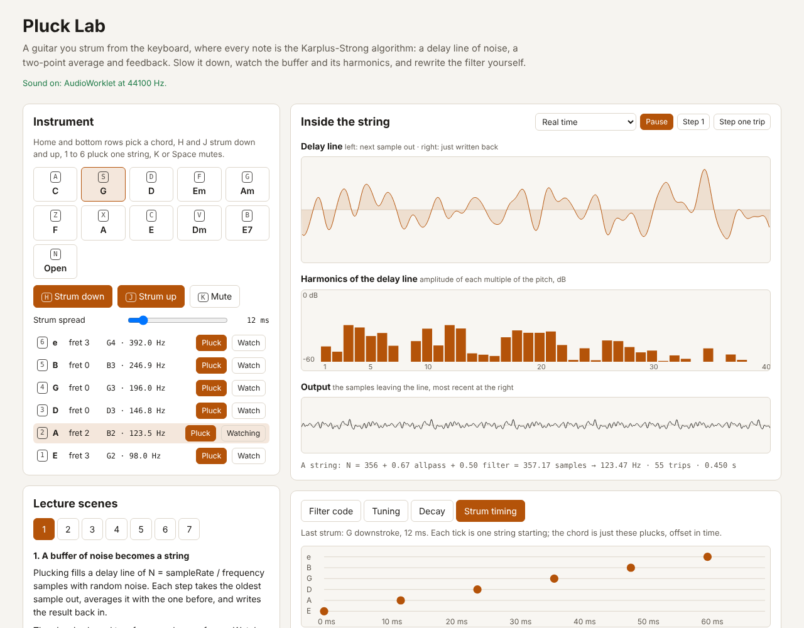

# Pluck Lab

A guitar you strum from the QWERTY keyboard where every note is synthesized
live by the Karplus-Strong algorithm: fill a delay line with noise, average
each sample with its neighbour, feed it back. Pluck Lab puts the inside of the
string on screen (the delay line, its harmonics and the output), lets you slow
it down to one sample per frame, walks through seven lecture scenes, and lets
students rewrite the loop filter and hear the result immediately.

Live: [pluck-lab.netlify.app](https://pluck-lab.netlify.app)

Built from idea 2026-10-16 n2 in
[`pisanuw/daily-project-ideas`](https://github.com/pisanuw/daily-project-ideas),
inspired by Guitoro (a sample-based keyboard guitar on Show HN). Pluck Lab
keeps the chord-and-strum keyboard idea but uses no samples at all.



## Playing

| Keys | Action |
|---|---|
| `A S D F G` | Chords C, G, D, Em, Am |
| `Z X C V B N` | Chords F, A, E, Dm, E7, open strings |
| `H` / `J` | Strum down / up |
| `1` to `6` | Pluck one string (low E to high e) of the current chord |
| `K` or `Space` | Mute (damp all strings) |

Everything is also clickable, so it works on a phone. Browsers only allow
sound after a gesture, so the first click or key press starts audio.

## What is on screen

- **Delay line.** The watched string's buffer in reading order: the left end
  leaves next, the right end was just written back. At slow speeds the two
  ends are marked.
- **Harmonics.** A direct DFT of the delay line, which holds exactly one
  period, so bar *k* is the amplitude of harmonic *k*. Fresh noise is uneven
  across all 40 bars; with a low-pass filter the high bars shrink trip by trip.
- **Output.** The samples leaving the line.
- **Readout.** `N + allpass + filter = period → Hz`, the cents error when
  fractional tuning is off, trips round the loop so far, and a warning if the
  loop clipped.
- **Panels.** Filter code (editor, plain-language analysis and gain-per-trip
  curve), Tuning (integer-delay error per note at the current rate and at
  8 kHz), Decay (seconds to fall 60 dB per open string) and Strum timing
  (when each string started in the last strum).

## Lecture scenes

1. **A buffer of noise becomes a string.** Slow motion; with and without the
   averaging.
2. **Why pitch is quantized.** Integer delay lines, the first-order allpass
   fix, and the same strum at 8 kHz where the error is a semitone.
3. **Why higher notes die faster.** Loss per trip times trips per second;
   "equal decay" compensates.
4. **The filter is the tone control.** The averaging weight S and ρ.
5. **Where you pick.** The comb filter on the excitation; β = 1/2 removes
   every even harmonic.
6. **A strum is six plucks a few milliseconds apart.** 0 ms, 12 ms, upstroke,
   80 ms arpeggio.
7. **Write your own filter.** Three-point average, a random-sign drum, and an
   unstable loop.

Each scene sets the sliders, filter and chord it needs and has buttons that
play the example, so a lecturer can step through without typing.

## The model

Per string, per sample:

```
x    = line[i]                       // oldest sample leaves the line
y    = filter(x, prev, state, p)     // default: ρ((1 - S)x + S·prev)
v    = C·y + y₋₁ - C·v₋₁             // first-order allpass, fractional delay
line[i] = clip(v, ±4); prev = x; i = (i + 1) mod N
```

- **Tuning.** The period `fs / f` is split into the integer line length `N`,
  the filter's phase delay (measured, 0.5 samples for the default) and an
  allpass delay `d ∈ [0.1, 1.1)` with `C = (1 - d) / (1 + d)`, after Jaffe
  and Smith (1983). With fractional tuning off, `N` is rounded instead and
  the table reports the error in cents.
- **Excitation.** Seeded zero-mean noise, comb-filtered with
  `1 - z^(-βN)` for the pick position, scaled to the pluck velocity.
- **Decay.** ρ per trip, optionally scaled per note as `ρ^(110 / f)` so high
  strings ring about as long as the A string.
- **Strums.** The chord's strings, low to high (down) or high to low (up,
  slightly softer), each started `spread` ms after the last.
- **Mixing.** Six strings summed, DC-blocked and soft-limited with `tanh`.

The same `Engine` class runs in an AudioWorklet (bundled by Vite as its own
script), in a ScriptProcessor fallback on browsers without AudioWorklet, and
in the unit tests. The views run a deterministic mirror of the watched string
with the same seed and parameters, which is what lets them slow down without
slowing the sound.

## Writing a filter

The code panel holds the body of `function (x, prev, state, p)`. `x` is the
sample leaving the line, `prev` the one before it, `state` a per-string
object for remembering anything else, and `p` holds `p.decay`, `p.weight`
and a seeded `p.random()`. Apply (or Ctrl+Enter) compiles it in strict mode,
smoke-tests it, and hot-swaps it into the audio thread; a syntax or runtime
error leaves the previous filter playing, and a filter that throws later is
replaced by the default with a message.

The idea suggested an optional Claude API call to explain a student's filter.
Pluck Lab does that deterministically instead: it checks the filter for
linearity and randomness, measures gain and phase delay at 48 frequencies by
least-squares fitting steady-state sinusoids, and turns that into sentences
(low-pass, flat, high-pass or uneven; unstable and at what frequency; the
predicted ring time of the A and high E strings; the delay it adds, which the
tuning then subtracts).

## Limitations

- It is the textbook model: no body resonance, no string stiffness or
  inharmonicity, no pitch bend, and the strings are mono. It sounds like a
  plucked string, not like a recorded guitar.
- Tuning compensation uses the filter's phase delay near DC. A filter whose
  delay changes a lot with frequency still plays its fundamental in tune but
  its upper partials drift, which is physically right but not shown.
- User filter code runs in your own browser tab with no sandbox beyond strict
  mode. That is fine for a student's own code; do not paste code you do not
  trust.
- Requested sample rates are a request: the browser may refuse a rate (the
  status line says so) and play at the device rate.
- The decay panel and the plain-language analysis only describe linear,
  non-random filters; for the drum and other nonlinear filters they say so
  and you have to listen.

## Development

```bash
npm install
npm run dev        # http://localhost:5173
npm run lint
npm run typecheck
npm run coverage   # 53 vitest tests, 100% statement coverage on src/core
npm run build      # static site in dist/
```

`src/core` (synthesis, analysis, guitar layout, scenes) is pure TypeScript
and fully unit-tested; `src/audio` is the Web Audio glue and `src/ui` the
DOM, both checked by hand and with a Playwright smoke run in a real browser.

Deploys to Netlify through the repo's config-driven workflow
(`deploy/target.yml`). No backend, no environment variables, no network
calls after the page loads.

## References

- K. Karplus and A. Strong, "Digital Synthesis of Plucked-String and Drum
  Timbres," *Computer Music Journal* 7(2), 1983.
- D. A. Jaffe and J. O. Smith, "Extensions of the Karplus-Strong
  Plucked-String Algorithm," *Computer Music Journal* 7(2), 1983.
