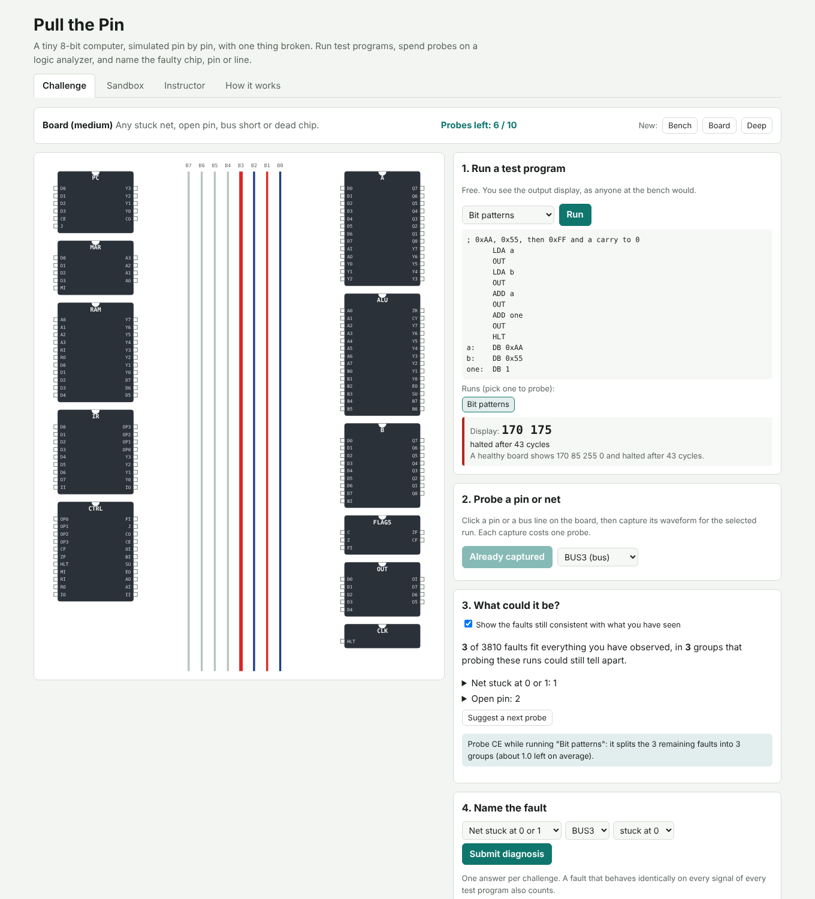

# Pull the Pin

A tiny 8-bit computer simulated chip by chip and pin by pin, with one thing
broken. Students run test programs for free, spend a limited budget of logic
analyzer probes on pins and bus lines, watch the set of faults consistent with
what they have measured shrink, and then name the faulty chip, pin, bus line
or microcode bit, the way a repair tech diagnoses a board.

Live: [pull-the-pin.netlify.app](https://pull-the-pin.netlify.app)

Built from idea 2026-10-18 n2 in
[`pisanuw/daily-project-ideas`](https://github.com/pisanuw/daily-project-ideas),
inspired by antirez's Commodore 64 hardware simulator (break chips and pins,
see the results) and an HN comment asking for the reverse: from symptom to
cause.



## The machine

A Ben Eater style SAP-1:

- an 8-bit bus with pull-down resistors,
- a 4-bit program counter (PC) and memory address register (MAR), 16 bytes of RAM,
- an instruction register (IR), A and B registers, an adder/subtractor (ALU), a
  flags register (carry, zero) and an output register,
- a microcode ROM (512 words, addressed by carry, zero, opcode and step) driving
  16 control lines: `HLT MI RI RO IO II AI AO EO SU BI OI CE CO J FI`.

Instructions: `NOP LDA ADD SUB STA LDI JMP JC JZ OUT HLT`, five clock cycles
each (two fetch, three execute). There is a small assembler (labels, `DB`,
`ORG`, `;` comments) so students can write their own test programs.

Each module is drawn and simulated as one idealized chip package: 11 chips,
168 pins, 52 nets. Every cycle settles in dependency order (register outputs,
control ROM, ALU, bus drivers), then the clock edge latches every register
whose load line is high. Signals are 0, 1 or Z. Two drivers on one net resolve
to the wired-AND (a low TTL output wins) and are flagged as bus contention. A
floating TTL input reads high, and the control inputs are active-high, so a
floating control pin asserts its line.

## Faults

| Kind | Effect |
|---|---|
| Stuck net | held at 0 or 1 whatever drives it |
| Open pin | the leg is lifted: an output no longer reaches its net (the pin itself still shows the chip driving it), an input floats high |
| Shorted bus lines | two adjacent bus lines, both read the wired-AND |
| Control ROM bit flip | one bit of one microcode word |
| Dead chip | outputs float, nothing latches; a dead clock never ticks |

That is 3,810 single faults. Challenges only use faults where at least one
of the four test programs shows a wrong display, so there is always a symptom.

## Modes

- **Challenge.** Three tiers: *Bench* (stuck bus line or dead chip, 12 probes),
  *Board* (anything but ROM flips, 10 probes) and *Deep* (everything, 8 probes).
  Running a program is free and shows the output display next to what a
  healthy board would show. Clicking a pin or bus line and pressing *Probe*
  captures that signal's whole waveform for the selected run on the logic
  analyzer, at the cost of one probe. One answer per challenge.
- **Consistent-fault view.** Every catalog fault is simulated on each program
  the student runs (in a Web Worker), each signal's waveform is hashed, and
  only faults whose hashes match every observation are kept. It also reports
  how many groups remain that probing those runs could still separate, which
  shows when only a new test program can help.
- **Suggest a next probe.** Picks the (program, signal) that minimizes the
  expected number of remaining faults. It reasons only from the faults that
  already fit the student's measurements. This replaces the optional Claude
  tutor in the original idea with deterministic logic.
- **Sandbox.** Inject any fault (or none) and run any program with every
  signal visible: registers, RAM, the control word and contention at the
  cursor, and analyzer rows that differ from a healthy board highlighted with
  the healthy waveform underneath.
- **Instructor.** Seeded challenge links (everyone with the link gets the same
  fault), hand-picked fault links with a custom probe budget, and the attempt
  log of this browser with CSV export.

Grading accepts the injected fault, or any fault that behaves identically on
every signal of every test program, since no probe could tell them apart.

## Limitations

- Modules are idealized single packages, not the real 74LS parts and pinouts,
  and timing is cycle-level: no propagation delay, glitches or analog levels.
- Single faults only.
- No backend: attempt logs stay in the browser that made them, and challenge
  links are obfuscated, not secret, so a determined student can decode one.
- The first analysis of each new program takes about a second in the worker.

## Development

```bash
npm install
npm run dev        # http://localhost:5173
npm run lint
npm run typecheck
npm run coverage   # vitest, thresholds 85%
npm run build
```

Layout: `src/core/` is the netlist, ISA and assembler, fault model, simulator,
diagnosis and challenge logic (all unit tested); `src/ui/` is the DOM, SVG
board, analyzer and the worker.

Deploys to Netlify through the repo's deploy workflow (`deploy/target.yml`).
