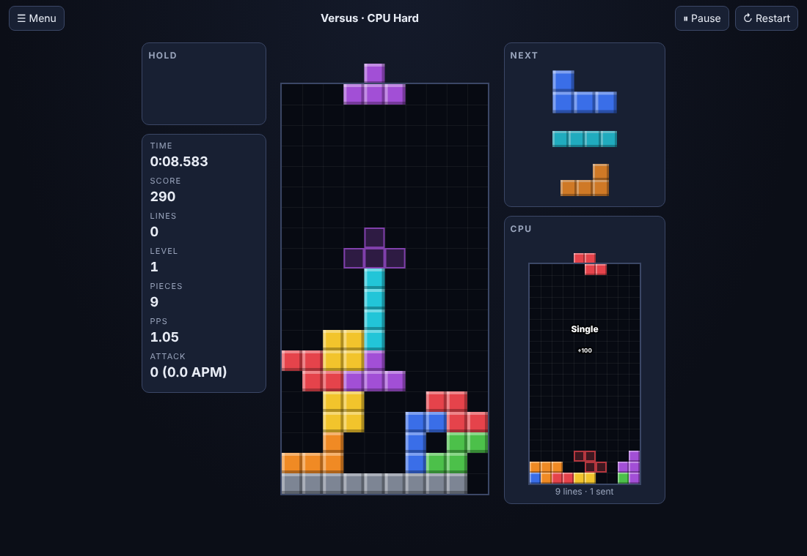

# Tetromino Arcade

A feature-rich, Tetris-style falling-block game that runs entirely in the
browser. It follows modern guideline rules (SRS rotation with wall kicks,
7-bag randomizer, hold, ghost piece, lock delay with move reset, T-spins,
back-to-back and combo scoring) and wraps them in seven modes, a CPU
opponent, exact replays, a daily challenge and local records.

Live: [tetromino-arcade.netlify.app](https://tetromino-arcade.netlify.app)

Requested directly (not taken from the
[`pisanuw/daily-project-ideas`](https://github.com/pisanuw/daily-project-ideas)
list). Not affiliated with The Tetris Company; "Tetris" is their trademark
and is used here only to describe the genre.



## Features

**Modes**

| Mode | Goal |
|---|---|
| Marathon | Clear 150 lines; speed rises every 10 lines. Choose a start level 1 to 15. |
| Sprint 40L | Clear 40 lines as fast as possible. |
| Ultra 2:00 | Highest score in two minutes. |
| Dig | Ten rows of "cheese" garbage (the hole never repeats a column); clear them all. |
| Master 20G | Pieces appear on the floor; lock delay shrinks from 30 to 12 frames. 100 lines. |
| Versus CPU | Send garbage to a CPU opponent (Easy, Normal, Hard, Insane). Same piece sequence for both sides. |
| Zen | Slow and endless: topping out clears the field instead of ending the game. |
| Daily Sprint | Sprint with a piece sequence seeded by today's date, so everyone plays the same pieces. |

**Rules engine** (`src/core/`)

- SRS rotation with the published JLSTZ and I kick tables, plus 180° rotation.
- 7-bag randomizer, 5-piece next queue (3 in versus), hold once per drop.
- Guideline gravity curve, 20G cap, 30-frame lock delay with up to 15 move
  resets (refreshed when the piece reaches a new lowest row).
- T-spin and mini T-spin detection (three-corner rule, front corners, and the
  "fifth kick" upgrade), back-to-back ×1.5, combos, perfect clear bonuses.
- Versus attack table (doubles 1, triples 2, Tetrises 4, T-spin doubles 4,
  back-to-back +1, combo table, perfect clear +10), garbage cancelling and a
  red incoming-garbage meter.
- Block out, lock out and garbage-out top-out conditions.

**Player experience** (`src/ui/`)

- Keyboard with rebindable keys, adjustable DAS, ARR (including instant) and
  soft drop speed; gamepad support; touch buttons and swipe gestures on phones.
- Ghost piece, optional grid, optional placement hint (the CPU's suggestion
  drawn as a dashed outline), particles, line-clear flash, screen shake,
  "T-Spin Double · 2 Combo" style popups.
- Four colour themes (Classic, Neon, Pastel light theme, Mono).
- Synthesised sound effects and an optional original music loop whose tempo
  follows the level (Web Audio, no audio files).
- 3-2-1 countdown, pause (auto-pause when the tab loses focus), quick restart.
- Results screen with time, score, PPS, keys per piece, clear breakdown,
  T-spins, max combo, perfect clears and versus attack; copy result to clipboard.
- Top-10 records per mode, lifetime stats, daily best.
- Replays: the seed plus every key press with its frame number. The best run
  in each mode is saved automatically; replays can be downloaded, loaded from
  a file and played back at 0.5× to 4×.

## Design decisions

- **Deterministic fixed-step core.** The game advances in 1/60 s frames, the
  bag and garbage holes come from a seeded PRNG (mulberry32), and input is
  applied at frame boundaries. That makes replays tiny and exact, and lets the
  tests replay a scripted game and compare boards cell by cell.
- **CPU without an LLM.** The opponent enumerates every rotation and column
  of its current and hold piece and scores the result with the six
  Dellacherie features using El-Tetris weights (landing height, eliminated
  cells, row and column transitions, holes, wells). Difficulty sets thinking
  time, action speed and how often it deliberately picks a worse placement.
- **No framework, no backend.** Plain TypeScript, DOM and Canvas; about
  53 kB of JavaScript. Records live in `localStorage`, with an in-memory
  fallback when storage is blocked.

## Limitations

- The CPU only considers hard-drop placements from above: it never tucks,
  slides under overhangs or sets up T-spins, so strong players beat Insane
  by T-spinning and sending back-to-back attack.
- There is no online multiplayer and records are per browser; the daily
  challenge has no shared leaderboard.
- Versus games are not recorded as replays (the CPU is deterministic, but
  replay files only describe single-player games).
- There is no line clear (ARE) delay or initial rotation/hold system (IRS/IHS).

## Development

```bash
npm install
npm run dev        # http://localhost:5173
npm run lint
npm run typecheck
npm run coverage   # 58 vitest tests, coverage thresholds 85%
npm run build      # static site in dist/
```

The core (`src/core/`) is pure TypeScript and unit tested (99% statement
coverage), including a CPU clearing 40 lines and full versus matches; the DOM
layer (`src/ui/`) was checked by driving it in a headless browser.

## License

MIT
